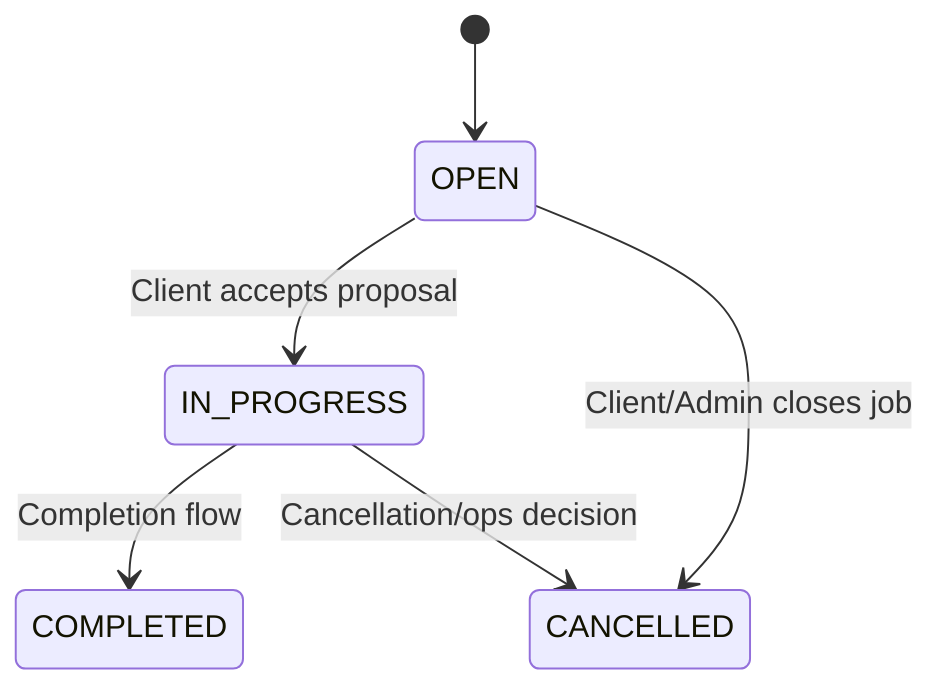
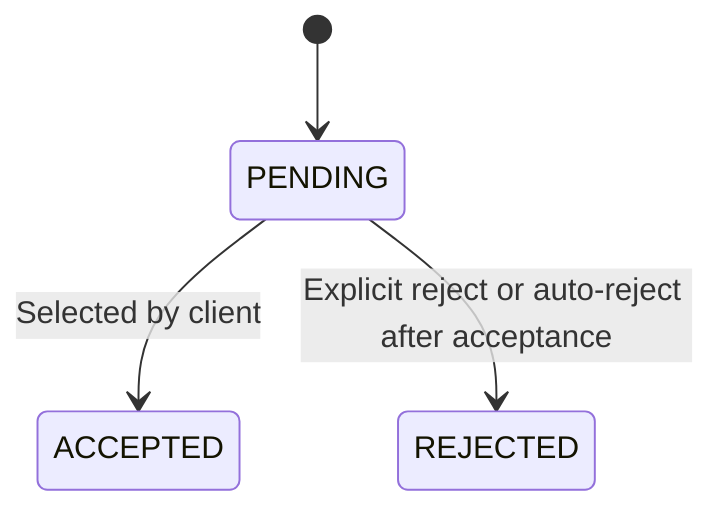
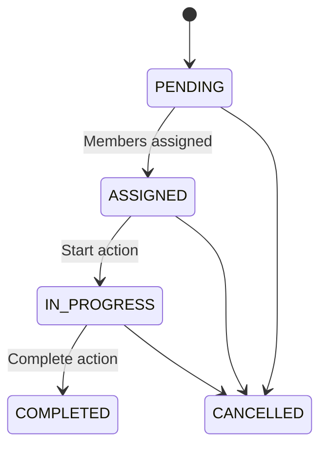

# Jobs Feature: End-to-End Documentation

Last updated: 2026-03-31 (execution plan added)

This document covers the Jobs feature only, end to end, including:

- UI surfaces and user journeys
- Role-based capabilities
- API contracts and business rules
- Data model and status transitions
- Team/agency job dispatch extension
- Edge cases and implementation notes

## 1. Scope and Definitions

### 1.1 Core marketplace Jobs

The core Jobs marketplace is the client-to-provider flow where:

1. A client posts a job.
2. Providers discover and apply with proposals.
3. Client reviews and accepts one proposal.
4. Job moves from OPEN to IN_PROGRESS to COMPLETED/CANCELLED.

### 1.2 Team dispatch Jobs

There is a second jobs subsystem for teams/agencies:

- Team owners create internal team jobs.
- Assign team members.
- Track execution and collection.

Both systems are documented here because they are implemented as job features in the same platform.

## 2. User Roles and What Each Can Do

## 2.1 Capability matrix

| Role                       | What they can do in Jobs                                                                                                                                           | UI entry points                                                                                       | API capabilities                                                                                                                                                                                  |
| -------------------------- | ------------------------------------------------------------------------------------------------------------------------------------------------------------------ | ----------------------------------------------------------------------------------------------------- | ------------------------------------------------------------------------------------------------------------------------------------------------------------------------------------------------- |
| Guest                      | Browse jobs and view job details                                                                                                                                   | `/jobs`, `/jobs/[id]`                                                                                 | `GET /api/jobs`, `GET /api/jobs/[id]`                                                                                                                                                             |
| Client                     | Post jobs, edit jobs, close jobs, view proposals, accept/reject proposals, message providers from proposals, and report disputes on accepted work                  | `/client/post-job`, `/client/jobs/[id]`, `/client/proposals`, `/client/messages`, `/client/dashboard` | `POST /api/jobs`, `PUT /api/jobs/[id]`, `GET /api/jobs/[id]/proposals`, `PATCH /api/jobs/[id]/proposals/[proposalId]`, `PUT /api/jobs/[id]` (status=CANCELLED), `POST /api/bookings/[id]/dispute` |
| Provider                   | Browse jobs, submit proposal, withdraw/edit pending proposal, track job tabs (recommended/available/applied/active/completed), and message clients from job detail | `/jobs`, `/jobs/[id]`, `/dashboard/jobs`, `/dashboard/messages`                                       | `POST /api/proposals`, `GET /api/proposals`, `PATCH /api/proposals/[id]`, `DELETE /api/proposals/[id]`, `GET /api/provider/jobs`                                                                  |
| Admin                      | Read job proposals and manage jobs by update/delete if needed                                                                                                      | Admin console + direct API access                                                                     | `GET /api/jobs/[id]/proposals` (allowed), `PUT/DELETE /api/jobs/[id]` (allowed)                                                                                                                   |
| Team Owner (provider team) | Create team jobs, assign members, start/complete, mark cash collected                                                                                              | `/dashboard/team/jobs`                                                                                | server actions in `src/app/actions/team.ts` + dispatcher service                                                                                                                                  |
| Team Member                | Receives assignments, can respond to assignment and status updates via team actions                                                                                | Team workspace flows                                                                                  | server action + dispatcher methods (assignment response, status updates)                                                                                                                          |

## 2.2 Access control notes

- Public pages include `/jobs` and `/jobs/[id]`.
- Dashboard pages are auth-gated and onboarding-gated in middleware/proxy.
- `POST /api/jobs` is restricted to `CLIENT`.
- `POST /api/proposals` and `GET /api/provider/jobs` are restricted to `PROVIDER`.
- Client proposal accept endpoint (`PATCH /api/jobs/[id]/proposals/[proposalId]`) only allows job owner.

## 2.3 Role flows: what each role does end to end

### Client flow (demand side)

1. Create job from `/client/post-job` (wizard).
2. Read own job in `/client/jobs/[id]` and monitor proposal count and activity.
3. Update job details while still managing demand (title, budget, location, images, status).
4. Read proposals (single-job and cross-job inbox) and compare candidates.
5. Accept one proposal, which auto-rejects remaining pending proposals and moves job to `IN_PROGRESS`.
6. Continue fulfillment through booking-level actions (cancellation/dispute/milestones when used).
7. Close/cancel job when needed.

### Provider flow (supply side)

1. Read opportunities in public jobs and provider dashboard tabs (`recommended`, `available`).
2. Create proposal for an open job (with checks for duplicate, cap, and weekly limits where applicable).
3. Read own proposal pipeline (`applied`, `active`, `completed`).
4. Update pending proposal (price, cover letter, ETA, attachments) if still in `PENDING`.
5. Delete/withdraw pending proposal if provider chooses not to continue.
6. Participate in accepted work via booking lifecycle actions (status/cancellation/dispute visibility and participation).

### Admin flow (moderation and control)

1. Read job proposals for oversight and quality/risk review.
2. Update jobs when operational intervention is required (moderation or correction).
3. Delete jobs when policy or operational constraints require hard removal.
4. Resolve disputes through admin resolution paths (`RESOLVED`/`CLOSED`) affecting booking/job continuity.

## 2.4 CRUD matrix (marketplace jobs)

### Jobs CRUD (`Job`)

| Role     | Create                        | Read                                           | Update              | Delete              |
| -------- | ----------------------------- | ---------------------------------------------- | ------------------- | ------------------- |
| Guest    | No                            | Yes (public jobs and job detail)               | No                  | No                  |
| Client   | Yes (own jobs only)           | Yes (public + own management views)            | Yes (own jobs only) | Yes (own jobs only) |
| Provider | No                            | Yes (public + provider dashboard aggregations) | No (job record)     | No                  |
| Admin    | No direct product create flow | Yes                                            | Yes                 | Yes                 |

### Proposals CRUD (`Proposal`)

| Role     | Create                  | Read                                                   | Update                                             | Delete                          |
| -------- | ----------------------- | ------------------------------------------------------ | -------------------------------------------------- | ------------------------------- |
| Guest    | No                      | No                                                     | No                                                 | No                              |
| Client   | No                      | Yes (all proposals on own jobs)                        | Decision update via accept/reject flow on own jobs | No direct delete                |
| Provider | Yes (own proposal only) | Yes (own proposals; own proposal on a job-scoped read) | Yes (own pending proposal only)                    | Yes (own pending proposal only) |
| Admin    | No                      | Yes (full proposal visibility)                         | No direct proposal edit path                       | No direct proposal delete path  |

### Booking/dispute/escrow CRUD (jobs-adjacent fulfillment)

| Role     | Create                                               | Read                     | Update                                                                      | Delete              |
| -------- | ---------------------------------------------------- | ------------------------ | --------------------------------------------------------------------------- | ------------------- |
| Client   | Create dispute and escrow milestones where permitted | Yes (participant-scoped) | Yes (participant-scoped status changes and milestone release where allowed) | No hard delete path |
| Provider | Create dispute where permitted                       | Yes (participant-scoped) | Yes (participant-scoped status/cancellation updates where allowed)          | No hard delete path |
| Admin    | No default create requirement                        | Yes                      | Yes (dispute resolution and ops actions)                                    | No hard delete path |

### Team jobs CRUD (`TeamJob`, internal dispatch)

| Role        | Create | Read                        | Update                                          | Delete                     |
| ----------- | ------ | --------------------------- | ----------------------------------------------- | -------------------------- |
| Team Owner  | Yes    | Yes                         | Yes (assign/start/complete/collection updates)  | Cancel flow (status-based) |
| Team Member | No     | Yes (assigned work context) | Limited status responses via assignment actions | No                         |

## 3. UI: End-to-End Flows

## 3.1 Public jobs browse (guest/provider/client)

Page: `src/app/jobs/JobsClient.tsx`

Key UI behavior:

- Sticky toolbar with:
  - Status tabs: OPEN, IN_PROGRESS, COMPLETED
  - Search (debounced)
  - Category filter
  - Verified clients toggle
  - Optional location picker
- Infinite scrolling list using `usePublicJobsInfinite`.
- Cards show:
  - Title, summary, budget, proposal count
  - Category, location, deadline
  - Client identity and verified badge
  - Distance in km when location is provided

## 3.2 Public job detail + apply flow

Page: `src/app/jobs/[id]/page.tsx`

What users see:

- Hero section with title, category, status, location, deadline, proposal count.
- Full description and image gallery.
- Client profile summary and verification badge.

Provider apply UX:

- Inline proposal form (conditional).
- Markdown cover letter editor with preview/split modes.
- Price and estimated days.
- Attachments (files and external links).
- Profile autofill option from provider profile.

Apply-state guards shown in UI:

- Not logged in -> prompted to login.
- Not provider -> blocked message.
- Job owner trying to apply -> blocked message.
- Existing proposal -> read-only status card.
- Job not OPEN -> blocked message.
- Max applicants reached -> blocked message.

## 3.3 Client post/edit job wizard

Page: `src/app/client/post-job/page.tsx`

Multi-step wizard:

1. Basics: title + category
2. Details: description + photos
3. Preferences: budget + location + maxApplicants
4. Review: confirmation summary

Key behavior:

- Supports both create and edit mode (`?edit=<jobId>`).
- Uploads images through `/api/upload` with progress state.
- Performs step validation and full form validation before submit.
- On submit:
  - create mode -> `POST /api/jobs`
  - edit mode -> `PUT /api/jobs/[id]`

## 3.4 Client manage job + proposals

Page: `src/app/client/jobs/[id]/page.tsx`

What client can do:

- View job metadata, budget, images, and stats.
- View proposals list.
- Accept a pending proposal.
- Message providers directly from proposal cards (opens existing messaging workspace).
- Edit job.
- Close job (set status to CANCELLED).
- Share job link.

Accept behavior:

- Accept selected proposal.
- Reject all other pending proposals.
- Set job status to IN_PROGRESS.

## 3.5 Client proposals workspace

Page: `src/app/client/proposals/page.tsx`

Capabilities:

- Aggregated proposal inbox across client jobs.
- Filters by job and status.
- Sorting presets (highest match, lowest price, fastest ETA, newest).
- Side-by-side comparison (up to 2 proposals).
- Accept/reject actions via server actions.

## 3.6 Provider jobs dashboard

Page: `src/app/dashboard/jobs/page.tsx`

Tabs:

- Recommended
- Available
- Applied
- Active
- Completed

Actions:

- Apply from available/recommended jobs.
- Withdraw pending proposal from applied jobs.
- View job modal details.
- Message clients from public job detail using the existing provider messages workspace.

Recommendation/urgency behavior:

- Recommended jobs are scored by category overlap, location match, applicant competition, budget, and near-term deadlines.
- Recommended cards expose match chips such as `Category Match`, `Nearby`, `Low Competition`, and `Urgent`.
- Ranking also factors provider history signals (`High Win Rate`, `Reliable History`) and short-horizon scheduling signal (`This Week`).

## 3.7 Team/agency job dispatch UI

Page: `src/app/dashboard/team/jobs/page.tsx`

Owner capabilities in UI:

- Create team job (title, amount, client info, location, schedule, description).
- Assign members to pending jobs.
- Move status from ASSIGNED -> IN_PROGRESS -> COMPLETED.
- Mark completed jobs as collected with payment method (CASH/MPESA/CARD).

Team jobs display:

- Job financials and collection status.
- Assigned members and assignment roles.
- Status pills for PENDING/ASSIGNED/IN_PROGRESS/COMPLETED/CANCELLED.

## 3.8 Admin moderation and intervention flow

Admin operations are primarily operational/moderation actions rather than marketplace participation:

1. Review job and proposal state for policy/risk checks.
2. Read all proposals on target jobs for investigation.
3. Update problematic jobs (status/details) when intervention is required.
4. Delete jobs when required by policy, fraud, or duplicate-cleanup workflows.
5. Resolve disputes (`RESOLVED` or `CLOSED`) to restore work or enforce cancellation/refund outcomes.

## 4. API Surface (Jobs only)

## 4.1 Jobs listing and creation

### `GET /api/jobs`

Purpose: public + authenticated job listing.

Supported query params:

- `page`, `pageSize`
- `status`
- `category`
- `location`
- `budgetMin`, `budgetMax`
- `search`
- `verifiedOnly=true`
- sorting: `sortBy`, `sortOrder`
- user coordinates: `latitude/longitude` or `userLat/userLon`

Behavior:

- Returns paginated payload with normalized item shape.
- Computes distance when user coordinates are provided.
- Can sort by distance.
- Includes proposal counts and client verification flag.

### `POST /api/jobs`

Auth: required, `CLIENT` only.

Validation (schema):

- title min 5
- description min 20
- category required
- budget positive
- location required
- maxApplicants optional positive int
- images optional string[]

Business logic:

- Resolves category by ID.
- Geocodes location and stores latitude/longitude.
- Creates job with status OPEN.
- Asynchronously sends job alerts to providers whose profile skills include the category ID.

## 4.2 Job detail, update, delete

### `GET /api/jobs/[id]`

Auth: public.
Returns job + client + category + proposal count.

### `PUT /api/jobs/[id]`

Auth: job owner client or admin.

Update fields:

- title, description, budget, location
- category (resolved by slug in this route)
- images
- status
- maxApplicants

### `DELETE /api/jobs/[id]`

Auth: job owner client or admin.
Deletes job.

## 4.3 Proposal endpoints (job-scoped)

### `GET /api/jobs/[id]/proposals`

Auth: required.
Allowed roles:

- admin
- job owner (client)
- provider

Visibility rule:

- Admin and job owner see all proposals.
- Provider sees only own proposal for that job.
- Proposal payload includes provider trust metadata used by client UI:
  - verification status
  - average rating and review count
  - provider skills and certifications count

### `POST /api/jobs/[id]/proposals`

Auth: required, provider only.

Validation:

- amount/price required (positive)
- message/coverLetter required (min 50)
- estimatedDays optional positive int
- attachments optional string[]

Business rules:

- Job must be OPEN.
- maxApplicants enforced when configured.
- One proposal per provider per job.

### `PATCH /api/jobs/[id]/proposals/[proposalId]`

Auth: required, job owner only.

Behavior:

- Accepts selected proposal (status -> ACCEPTED)
- Rejects other pending proposals for same job
- Sets job status -> IN_PROGRESS
- Creates a linked booking (if missing) so cancellation/dispute/completion workflows are available.
- Creates an escrow-lite pending payment hold for newly-created booking records.

## 4.4 Proposal endpoints (provider-scoped)

### `POST /api/proposals`

Auth: required, provider only.

Validation:

- `coverLetter` min 50
- `price` positive
- `jobId` required
- optional `estimatedDays`, `attachments`

Business rules:

- Job must be OPEN.
- Provider can submit only once per job.
- maxApplicants enforced when configured.
- Weekly limit enforcement for FREE/inactive subscription providers:
  - 14 proposals/week included.
  - Extra proposals cost lead credits (2 credits/proposal).
  - Returns 429 if insufficient credits.

### `GET /api/proposals`

Auth: provider only.
Lists provider proposals with pagination and optional status filter.

### `GET /api/proposals/[id]`

Auth: provider who owns proposal OR client who owns related job.

### `PATCH /api/proposals/[id]`

Auth: proposal owner provider only.
Only allowed while proposal status is PENDING.

### `DELETE /api/proposals/[id]`

Auth: proposal owner provider only.
Only allowed while proposal status is PENDING.

## 4.5 Provider jobs aggregation endpoint

### `GET /api/provider/jobs`

Auth: provider only.

Query params:

- `tab=recommended|available|applied|active|completed`
- `page`, `pageSize`
- optional `category` on available tab

Tab behavior:

- recommended: OPEN jobs (not yet applied by provider), ranked by recommendation signals
- available: OPEN jobs where provider has not applied
- applied: jobs where provider has proposals
- active: accepted proposals (with booking context when present)
- completed: accepted proposals where job status is COMPLETED
- `available` total is now DB-accurate (computed with provider exclusion in query), not post-filtered approximation.

## 4.6 Booking dispute and cancellation APIs

### `PATCH /api/bookings/[id]`

Auth: required, booking participant (client/provider).

Behavior additions:

- Supports `cancellationReason` when status is set to `CANCELLED`.
- Persists `cancelledAt`, `cancelledBy`, and `cancellationReason`.
- Escrow-lite transitions:
  - `COMPLETED` moves booking payment from `PENDING` to `COMPLETED`.
  - `CANCELLED` moves booking payment to `REFUNDED`.

### `POST /api/bookings/[id]/dispute`

Auth: required, booking participant (client/provider).

Behavior:

- Creates a dispute (reason min 20 chars).
- Prevents duplicate dispute per booking.
- Updates booking status to `DISPUTED`.

Admin resolution behavior:

- `RESOLVED` sets dispute status and restores booking to `IN_PROGRESS` (or keeps `COMPLETED` if already completed).
- `CLOSED` sets dispute status, cancels booking, and refunds booking payment.

### `GET /api/bookings/[id]/escrow/milestones`

Auth: required, booking participant or admin.

Behavior:

- Returns booking escrow milestone plan when configured.
- Includes booking/payment snapshot for escrow visibility.

### `POST /api/bookings/[id]/escrow/milestones`

Auth: required, booking client or admin.

Behavior:

- Configures milestone escrow plan (sum of milestone amounts must equal booking total).
- Ensures a booking payment hold exists (`PENDING`) for escrow settlement.

### `PATCH /api/bookings/[id]/escrow/milestones`

Auth: required, booking client or admin.

Behavior:

- Releases one milestone by `milestoneId`.
- Keeps payment `PENDING` for partial releases.
- Marks payment `COMPLETED` when all milestones are released.

## 4.7 Client dashboard jobs endpoint

### `GET /api/client/jobs`

Auth: required.
Roles allowed in route: CLIENT and PROVIDER.

Behavior:

- Returns current user's jobs by `clientId`.
- Used by client dashboard cards and counts.

## 5. Data Model and Status Lifecycles

## 5.1 Core enums

### UserRole

- CLIENT
- PROVIDER
- ADMIN

### JobStatus

- OPEN
- IN_PROGRESS
- COMPLETED
- CANCELLED

### ProposalStatus

- PENDING
- ACCEPTED
- REJECTED

### TeamJobStatus

- PENDING
- ASSIGNED
- IN_PROGRESS
- COMPLETED
- CANCELLED

### AssignmentStatus

- PENDING
- ACCEPTED
- DECLINED
- IN_PROGRESS
- COMPLETED

## 5.2 Core models

### Job

Key fields:

- `clientId`, `categoryId`
- `title`, `description`
- `budget`, `location`, `latitude`, `longitude`
- `deadline`, `maxApplicants`
- `status`
- `images[]`

Relations:

- belongs to client user and category
- has many proposals
- optional relation to bookings

### Proposal

Key fields:

- `jobId`, `providerId`
- `coverLetter`, `price`
- `estimatedDays`, `attachments[]`
- `status`

### TeamJob + TeamJobAssignment

Team job fields include:

- schedule, location json, amount
- collection tracking and payment method
- optional link to booking

Assignments track:

- member, role (LEAD/WORKER/HELPER)
- assignment status and timing events

## 5.3 Lifecycle transitions

### Marketplace job lifecycle

### Proposal lifecycle

### Team job lifecycle

## 6. Business Rules and Validation Summary

## 6.1 Job posting rules

- Only clients can create jobs.
- Category must be valid.
- Budget must be positive.
- Location is required for create flow.
- Job can optionally cap applicants (`maxApplicants`).

## 6.2 Proposal rules

- Only providers can submit proposals.
- Proposal blocked when job is not OPEN.
- One proposal per provider per job.
- maxApplicants cap enforced in job-scoped proposal route.
- Provider can edit/withdraw only while proposal is PENDING.

## 6.3 Client decision rules

- Client can accept proposal only on own jobs.
- Accepting one proposal rejects all other pending proposals.
- Accepting proposal transitions job to IN_PROGRESS.

## 6.4 Team dispatch rules

- Assignment moves team job to ASSIGNED.
- Completing team job marks assignments complete and moves members back ONLINE.
- Collection is tracked separately from completion.

## 7. Notifications and Side Effects

### Job alerts on creation

When a job is created:

- Matching providers (by skill/category) are selected.
- Comprehensive notification is sent asynchronously.
- Email subject and payload include job title, category, location, budget, and CTA.

### Proposal notifications

- When a provider submits a proposal through `/api/proposals`, the job owner receives:
  - Database notification record
  - Push notification (if enabled)
  - Email notification (if enabled)
- Notification payload includes provider name, job title, proposed amount, and a direct review link.

## 8. UI Components and Hooks (Reference)

### Key pages

- `src/app/jobs/page.tsx`
- `src/app/jobs/JobsClient.tsx`
- `src/app/jobs/[id]/page.tsx`
- `src/app/client/post-job/page.tsx`
- `src/app/client/jobs/[id]/page.tsx`
- `src/app/client/proposals/page.tsx`
- `src/app/dashboard/jobs/page.tsx`
- `src/app/dashboard/team/jobs/page.tsx`

### Key APIs

- `src/app/api/jobs/route.ts`
- `src/app/api/jobs/[id]/route.ts`
- `src/app/api/jobs/[id]/proposals/route.ts`
- `src/app/api/jobs/[id]/proposals/[proposalId]/route.ts`
- `src/app/api/proposals/route.ts`
- `src/app/api/proposals/[id]/route.ts`
- `src/app/api/provider/jobs/route.ts`
- `src/app/api/client/jobs/route.ts`

### Key hooks

- `src/lib/api/hooks/usePublicJobs.ts`
- `src/lib/api/hooks/useJobs.ts`
- `src/lib/api/hooks/useClientDashboard.ts`
- `src/lib/hooks/useDashboardJobs.ts`

## 9. Known Implementation Notes (Important)

1. There are two proposal creation endpoints in active use:

- `/api/jobs/[id]/proposals` (job-scoped)
- `/api/proposals` (provider-scoped, includes weekly limit and credits logic)

2. Validation/business rules for proposal creation are unified via shared submission service:

- minimum cover letter threshold is 50 chars on both paths
- duplicate prevention, job status checks, maxApplicants checks, and credit-limit enforcement are shared

3. Provider available jobs totals are computed directly in DB using proposal exclusion conditions.

4. `PUT /api/jobs/[id]` resolves category by slug, while create resolves category by ID.

5. Team jobs are internal operational jobs and may optionally link to booking records but do not require booking linkage.

## 10. End-to-End Summary

Jobs in this platform are implemented as two connected layers:

- Public marketplace jobs (client posts, provider applies, client selects).
- Team dispatch jobs (owner assigns crew and tracks operational completion/collection).

For each role:

- Guests discover opportunities.
- Clients create and manage demand.
- Providers compete through proposals and track pipeline states.
- Admins retain moderation/control via update/delete and proposal visibility.
- Team owners and members execute real-world fulfillment through dispatch tooling.

## 11. Product Optimization Plan (Execution to Completion)

This section converts current product feedback into implementation-ready work.

Goal: improve decision speed, trust confidence, and marketplace liquidity without breaking existing Jobs flows.

## 11.1 Phase roadmap

### Phase 1: Decision UX (highest priority)

Deliverables:

1. Proposal recommendation labels on client proposal cards:

- `Best Value`
- `Fastest Delivery`
- `Most Reliable`
- `Lowest Cost`

2. Single highlighted `Recommended Provider` per job.
3. Risk framing signals:

- `New provider`/limited history
- response-time warning
- completion-rate confidence

Acceptance criteria:

- Every proposal in client review has 0..N badges.
- Exactly one proposal is marked `Recommended Provider` for jobs with at least one eligible proposal.
- Recommendation explanation text is visible (why selected).

### Phase 2: Provider speed and conversion

Deliverables:

1. Quick Apply from provider surfaces with profile-based autofill.
2. Proposal templates (save, reuse, edit before submit).
3. Win-probability indicator on provider job cards:

- `High chance`
- `Medium chance`
- `Highly competitive`

Acceptance criteria:

- Provider can submit via Quick Apply in fewer steps than full form.
- Provider can create/update/delete templates and use one in proposal compose.
- Win-probability chip visible in `recommended` and `available` tabs.

### Phase 3: Trust and intelligence

Deliverables:

1. Behavioral metrics on proposal/provider trust panel:

- response rate
- average response time
- jobs completed

2. Outcome metrics:

- successful jobs count
- repeat clients count

3. Client-side intelligence hints:

- alignment with client historical hiring behavior.

Acceptance criteria:

- Metrics appear consistently in proposal detail cards where data exists.
- Missing data falls back to neutral labels (no empty/broken states).
- Client insight hints are generated only for authenticated clients with history.

### Phase 4: Differentiation and fulfillment visibility

Deliverables:

1. Team-marketplace integration model:

- provider entity can fulfill as individual or team.

2. Payment timeline UI:

- Accepted -> Funds Held -> Work Ongoing -> Release Payment

3. Milestone escrow visualization:

- progress bar + released/pending split.

4. Urgency/activity signals:

- applicant count
- client recent activity
- deadline countdown.

Acceptance criteria:

- Team fulfillment path is selectable for eligible providers.
- Booking payment state is understandable at a glance from timeline component.
- Urgency/activity chips update from current API values and never block page load.

## 11.2 Required API and data additions

These are additive changes; existing endpoints remain backward compatible.

### A) Proposal recommendation payload (client-facing)

Add derived fields to proposal list payloads used by client proposal screens:

- `recommendationLabel?: 'BEST_VALUE' | 'FASTEST' | 'MOST_RELIABLE' | 'LOWEST_COST'`
- `isRecommended?: boolean`
- `recommendationReason?: string`
- `riskFlags?: string[]`

### B) Trust metrics payload (provider profile summary)

Add fields:

- `responseRatePct?: number`
- `avgResponseTimeMinutes?: number`
- `jobsCompletedCount?: number`
- `repeatClientsCount?: number`
- `successfulJobsCount?: number`

### C) Provider efficiency payload

For provider jobs endpoint (`GET /api/provider/jobs`), add:

- `winProbabilityBand?: 'HIGH' | 'MEDIUM' | 'LOW'`
- `winProbabilityReason?: string`
- `suggestedPrice?: number`
- `quickApplyTemplateId?: string`

### D) Proposal templates

New endpoint family (provider-only):

- `GET /api/proposal-templates`
- `POST /api/proposal-templates`
- `PATCH /api/proposal-templates/[id]`
- `DELETE /api/proposal-templates/[id]`

Suggested model:

- `ProposalTemplate { id, providerId, name, coverLetter, priceHint?, estimatedDaysHint?, createdAt, updatedAt }`

### E) Runtime feature flags and tuning knobs (implemented)

Client recommendation UI is controlled by runtime flags in proposal review surfaces:

- `NEXT_PUBLIC_FF_CLIENT_PROPOSAL_RECOMMENDATIONS`
  - `true`: show recommendation labels, recommended provider highlight, risk signals, confidence bar, and recommendation rationale panel.
  - `false`: hide recommendation-specific UI and keep baseline proposal review experience.

Recommendation confidence band thresholds are tunable without code changes:

- `NEXT_PUBLIC_RECOMMENDATION_CONFIDENCE_HIGH` (default `80`)
- `NEXT_PUBLIC_RECOMMENDATION_CONFIDENCE_MEDIUM` (default `60`)

Validation behavior:

- Values are clamped to range `0..100`.
- Invalid or missing values fallback to defaults.
- Medium threshold is automatically bounded so it does not exceed high threshold.

Recommended rollout presets:

- Conservative: `HIGH=85`, `MEDIUM=65`
- Balanced: `HIGH=80`, `MEDIUM=60`
- Aggressive: `HIGH=75`, `MEDIUM=55`

## 11.3 UI implementation map

### Client-side pages

- `src/app/client/proposals/page.tsx`
  - add recommendation badges and risk cards
  - highlight one recommended provider
- `src/app/client/jobs/[id]/page.tsx`
  - show recommendation summary in proposal list
  - show trust metrics inline

### Provider-side pages

- `src/app/dashboard/jobs/page.tsx`
  - add win-probability chip and quick-apply action
- `src/app/jobs/[id]/page.tsx`
  - add quick-apply autofill option and template selector

### Fulfillment visibility surfaces

- booking/payment UI components used in client/provider job contexts
  - add payment timeline
  - add milestone release progress visualization

## 11.4 Rollout strategy

1. Ship Phase 1 behind feature flags for proposal screens.
2. A/B test recommendation highlight impact on acceptance latency.
3. Ship Phase 2 to a small provider cohort first (templates + quick apply).
4. Expand metrics and intelligence after data quality verification.
5. Roll out Phase 4 after team-fulfillment policy rules are finalized.

## 11.5 Success metrics (must be tracked)

Primary:

- median time from first proposal view to client acceptance
- proposal-to-acceptance conversion rate
- provider proposal submission completion rate

Secondary:

- dispute rate per completed booking
- cancellation rate post-acceptance
- repeat-client hire rate

Guardrails:

- no increase in erroneous accept/reject operations
- no regression in proposal API latency beyond agreed SLO

## 11.6 Definition of done

This optimization work is complete when:

1. All four phases are shipped with feature flags and observability.
2. CRUD and role permissions remain unchanged unless explicitly approved.
3. New recommendation and trust fields are additive and documented in API docs.
4. At least one full cycle of post-release metrics review confirms positive movement in primary KPIs.
